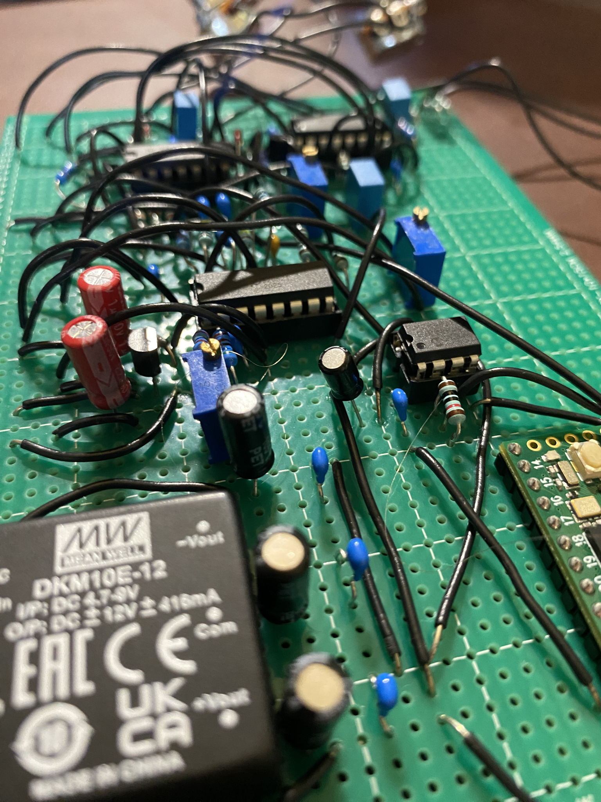
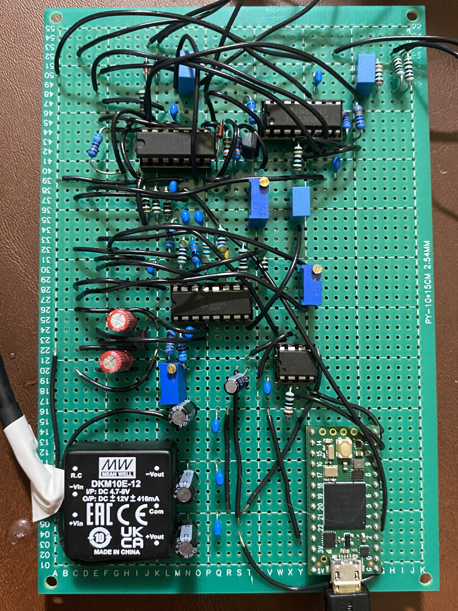

# Analog MIDI Synthesizer

  

## Overview

A USB MIDI keyboard sends notes through a computer to the Teensy 4.0. The Teensy communicates with an MCP4821 DAC over SPI to generate a pitch-control voltage for an AS3340 analog sawtooth oscillator. A separate analog attack/release envelope controls an LM13700 voltage-controlled amplifier (VCA), allowing notes to fade in and out.

The audio circuitry is assembled on perfboard and connected to powered speakers through a 3.5 mm line output.

## Features

- Monophonic USB-MIDI keyboard control
- Analog sawtooth waveform with DAC-controlled pitch
- Adjustable Attack and Release
- LM13700 voltage-controlled amplitude envelope
- Hand-soldered, perfboard construction

## Hardware

| Component | Role |
|---|---|
| Teensy 4.0 | Receives MIDI notes and generates pitch and gate commands |
| MCP4821 (12-bit DAC) | Converts SPI pitch commands to analog voltage |
| AS3340 | Generates the analog sawtooth waveform |
| TL074 and 2N3906 | Gate, envelope buffering, VCA bias control, and audio output |
| LM13700 | Controls the amplitude of the oscillator signal |
| DKM10E-12 and L79L05 | Provide ±12 V and −5 V analog supply rails |
| Resistors, capacitors, and 1N4148 diodes | Set oscillator timing and bias, create the RC attack/release paths, and provide signal conditioning and decoupling |
| Perfboard and potentiometers | Permanent circuit assembly and Attack/Release adjustment |

The Teensy is powered by its computer USB connection, while a separate 5 V supply powers the analog rails. Their grounds are shared, but their 5 V supplies are kept separate.

## Circuit Operation

**Pitch control:** The Teensy translates incoming MIDI note numbers into DAC codes. The DAC's output voltage controls the AS3340 oscillator frequency. Because the oscillator's pitch-input circuit uses a 61.9 kΩ resistor, it requires approximately 0.62 V per octave instead of 1 V per octave.

**Attack and Release:** When a note is pressed, an analog capacitor charges through the Attack potentiometer. When the final key is released, it discharges through the Release potentiometer. Steering diodes separate the paths so the two controls work independently. The resulting envelope changes the LM13700's gain, while the sawtooth waveform itself remains analog.

## Construction and Testing

I assembled the circuit on perfboard and verified it in stages using a digital multimeter and powered speakers. Tests included checking the supply rails, DAC voltages, MIDI gate behavior, oscillator pitch changes, and envelope charging/discharging.

  

  

The completed synthesizer plays MIDI-controlled notes, responds to pitch changes, and has independently adjustable attack and release knobs.

**Design files:** [Electrical schematic (PDF)](Hardware/synth_schematic.pdf) · [Perfboard layout (PDF)](Hardware/perfboard_sketch.pdf)
**Firmware:** [Teensy MIDI sketch](Firmware/analog_synthesizer.ino)

## Demo

**[▶ Watch analog synthesizer demo](https://youtu.be/jd_qomO2di8)**